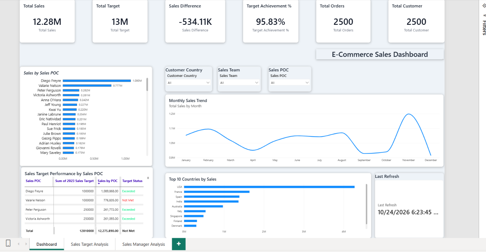

# E-Commerce Sales Dashboard (Power BI)

## Business Problem
An e-commerce business wants one view of its 2023 sales performance: how sales trend over time, which countries and sales people drive revenue, and whether sales targets are being met.

## Dataset
Case-study dataset with three tables:
- **Orders:** 2,500 orders (Jan to Dec 2023) with customer country, order source, sales POC and order value
- **Customers:** 2,500 customers across 14 countries
- **Sales Targets:** 2023 targets for 92 sales POCs across 5 sales teams and 30 sales managers

## Tools Used
Power BI, DAX

## Dashboard Pages
1. **Dashboard:** KPI cards (Total Sales, Total Orders, Total Customers, Total Target, Sales Difference, Target Achievement %), monthly sales trend, top 10 countries by sales, sales by sales POC and target status (Met / Not Met)
2. **Sales Target Analysis:** 2023 target vs actual sales by sales POC
3. **Sales Manager Analysis:** target achievement % by sales manager

## Interactivity
Dropdown slicers for Customer Country, Sales Team and Sales POC.

## Key DAX Measures
Total Sales, Total Orders, Total Customer, Total Target, Sales Difference, Target Achievement %, Target Status

## Key Findings
- Total sales were about 12.28M against a target of 12.81M, an achievement of 95.8%
- The USA is the largest market with about 4.27M in sales (around 35% of total)
- 37 of 92 sales POCs met their 2023 target; 55 did not
- November 2023 was the highest-selling month

## Dashboard Preview

## Files
- `E-comm.pbix` : Power BI report
- `ecommerce_orders_dataset.xlsx` : source data (Orders, Customers, Sales Targets)
- `dashboard.png` : dashboard screenshot
